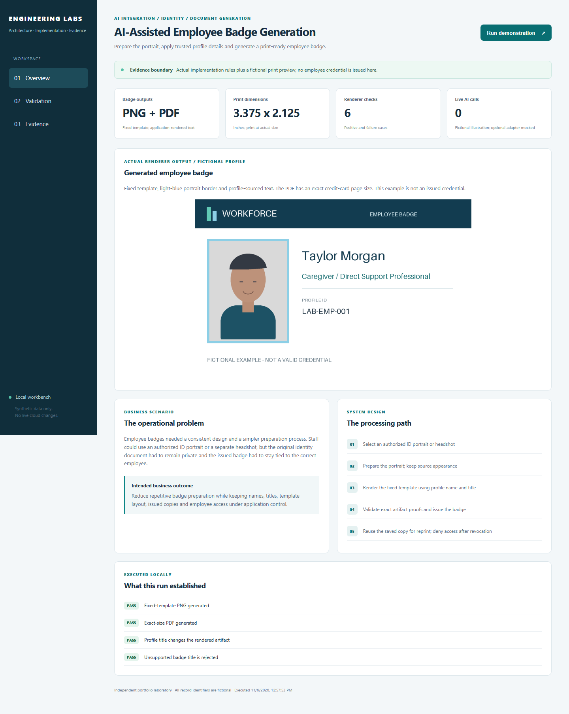
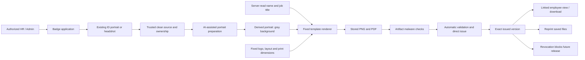
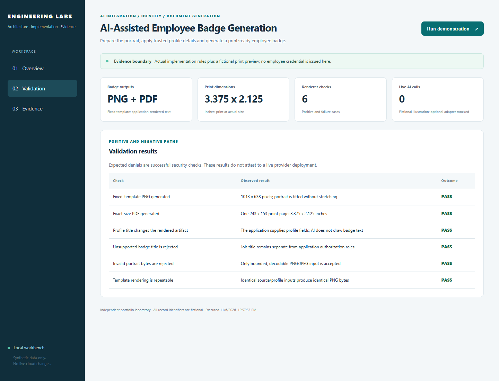
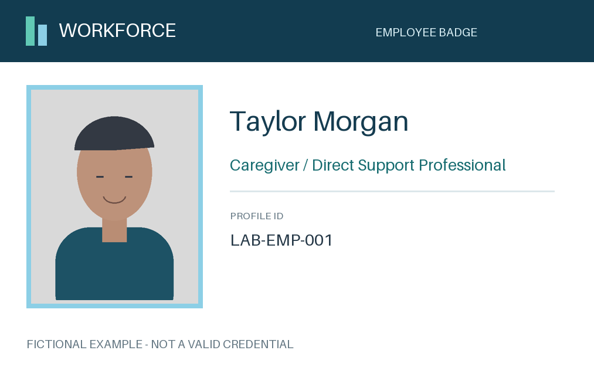

# AI-Assisted Employee Badge Generation

**Turn an approved employee photo into a consistent, print-ready badge.**

[The problem](#the-business-problem) · [The solution](#the-solution) · [What was built](#what-was-built) · [Proof it works](#proof-it-works) · [Commands](docs/COMMANDS.md) · [Step by step](#step-by-step)



## The Business Problem

Preparing badges by hand takes time and can produce inconsistent results. Staff may start with an authorized ID image or a separate headshot, but the original ID must remain private. The photo, name, title and issued files must all stay connected to the right employee.

## The Solution

Prepare the portrait, then place it in a fixed badge design using the employee’s saved name and job title. Check the current photo, profile and file-scan results before issuing the badge. Save the exact issued copies so employees can view them and staff can reprint or revoke them.

**Business outcome:** Reduce repetitive editing while keeping employee details, badge design, issued copies and access under application control.

### Actual implementation

This case study comes from the workforce platform I built and operated. It includes selected implementation source and executable tests, related Terraform and operational lessons. The public examples omit employee records, credentials, cloud IDs and private source documents.

- Built portrait preparation from an existing authorized ID image or a standalone headshot, with source appearance and hairstyle preservation.
- Kept the template, logo, employee profile name and job title application-controlled; produced print-ready PNG/PDF badge artifacts.
- Implemented direct issuance, saved versions, reprints, revocation and protected employee self-service.
- Used a versioned Key Vault credential binding and separate operational controls for paid image cleanup and retention of unused badge files.

The included local preview is a reproducible example. It does not replace actual nonproduction portal acceptance. [The evidence guide](docs/VALIDATION.md) distinguishes source tests, local output and cloud observations.

## Step by Step

A short walkthrough of the process, with technical instructions and evidence limits in the sections below.

1. **Select an authorized photo** — Use the employee photo from an approved identification image or a separate headshot. Check that the source belongs to the selected employee and has the required file-check status.

2. **Prepare the portrait** — The preparation process crops and cleans the portrait while aiming to preserve the person's appearance. The public example leaves the paid AI connection off by default.

3. **Apply the fixed badge design** — The application places the portrait into the saved template with the employee profile name and job title. The template and logo stay under application control.

4. **Issue and manage the badge** — Save the issued files for protected employee viewing and staff reprints. Revocation marks a badge unavailable through the application without silently generating a new copy.

## Architecture



## What Was Built

| Component | Role in plain words | Implementation |
| --- | --- | --- |
| Actual source-selection rules | Resolve one current authorized ID portrait or headshot and verify exact scan lineage. | [View code](reference/badgeWorkflow.ts) |
| AI portrait preparation boundary | Prepare the portrait while keeping the person’s appearance and hairstyle, and use a neutral-gray background. The public AI connection is Off by default. | [View code](lab/portrait_ai.py) |
| Fixed-template renderer | Apply profile name, controlled job title and artwork separately from AI; export PNG and exact-size PDF. | [View code](lab/render.py) |
| Actual issue/reprint/revoke rules | Bind issuance to current metadata and stored artifacts; reprint without rendering or calling AI again. | [View code](reference/badgeIssuance.ts) |
| Actual employee self-service rules | Release only the linked employee's latest, owned, clean and unrevoked issued file. | [View code](reference/badgeSelfService.ts) |
| Limited storage and secret access | Keep badge files private, limit scan access to those containers and optionally allow access to one selected secret without including its value. | [View code](infra/main.tf) |

## Proof It Works

Run from the repository root. Commands are explained in [the command reference](docs/COMMANDS.md).

### 1. Actual badge ownership and lifecycle tests pass

The extracted implementation checks source/profile changes, direct issue, repeat safety, immutable reprints and revocation. It also tests the employee self-service boundary.

```bash
npm run test:source
```

**What to look for:** Twenty-one actual source tests pass. Direct issuance performs automatic validation; a manual comparison step is not mandatory.

### 2. A real PNG and print-sized PDF are generated

The public renderer uses a fictional profile and original code-drawn illustration. The preview is real renderer output, not an AI quality sample or a live credential.

```bash
python -B -m lab render --out .local/badge-preview
```

**What to look for:** The output folder receives fictional-badge.png and fictional-badge.pdf. The PDF page is exactly 243 x 153 points: 3.375 x 2.125 inches.

### 3. The renderer and optional AI boundary are checked

The local tests cover profile-bound output, controlled titles, image validation, repeatable PNGs and mocked image-edit failures.

```bash
python -B -m unittest discover -s tests -v
```

**What to look for:** Sixteen Python tests pass. No API key or paid request is used. The source-platform image quality is not inferred from a mocked transport.

### 4. Visible output

The workbench shows the executed checks and fictional records. Desktop/mobile views, rerun behavior and access restrictions were checked. See [dated validation](docs/VALIDATION.md) for scope and counts.





[Open the print-sized sample PDF](docs/samples/fictional-badge.pdf). This sample is visibly marked as fictional.

## Security Practices

- The real source ID stays private and is not the employee's downloadable badge artifact. Public examples contain no real employee image.
- The AI edits the portrait only. It does not draw trusted badge text or grant an application role.
- Issued copies require current employee binding and exact clean artifact proofs. Revocation prevents future release; it cannot recall a previously printed/downloaded copy.
- The public image adapter is Off by default, makes one bounded request when explicitly invoked and has no automatic paid retries.

The [security guide](SECURITY.md) explains trust boundaries. State, plans, credentials and local output stay out of Git.

## Run It Locally

Requires Python 3.12 and Node.js 22.18 or newer for the extracted TypeScript tests. The accepted source run used Node 22.23.2. No Node package installation is needed for the source tests.

```bash
python -m venv .venv
source .venv/bin/activate
python -m pip install -r requirements.txt
npm run test:source
python -B -m unittest discover -s tests -v
python -B -m lab demo
python -B -m lab serve --port 8011
```

Windows: use `.venv\Scripts\python.exe` for the Python commands and `npm.cmd` if PowerShell blocks `npm.ps1`. Open [the loopback workbench](http://127.0.0.1:8011). Stop it with Ctrl+C. The [walkthrough](docs/WALKTHROUGH.md) connects these commands to each processing step.

## Terraform Infrastructure

Two private badge containers on an existing scan-protected storage account, a reference application identity, container-specific roles and optional exact-secret access. This root does not deploy the business API or activate paid image cleanup.

```bash
terraform -chdir=infra init -backend=false -input=false
terraform -chdir=infra fmt -check -recursive
terraform -chdir=infra validate
terraform -chdir=infra test
```

These are local schema/mock-plan checks, not a cloud apply. Read [the infrastructure guide](infra/README.md) and [example inputs](infra/example.tfvars.example) before any separate commissioning.

## Scaling and Tradeoffs

Keep preparation requests idempotent, bound AI concurrency and daily admission in a durable store, and retain prompt/model/source lineage. Serve saved issued files rather than paying for regeneration on each reprint. Expire only unissued/unused material under a reviewed retention policy.

Read [strengths, weaknesses and tradeoffs](docs/SCALING.md) for the operating decisions.

## Skills Demonstrated

- AI image-edit integration and source preservation
- Fixed-template PNG/PDF document generation
- Employee identity, ownership and lifecycle controls
- Versioned Key Vault references and scoped Blob access
- Idempotency, immutable artifacts and recovery

## Troubleshooting Lessons

An automated appearance pass did not guarantee that a portrait looked suitable. Source comparison exposed hairstyle changes, while uncertain paid requests and protected file checks still required separate handling. [Read the incident, evidence and verification](docs/LESSONS-LEARNED.md).

## Project Guides

| Guide | Purpose |
| --- | --- |
| [Architecture](docs/ARCHITECTURE.md) | Follow the actual service and trust boundaries |
| [Walkthrough](docs/WALKTHROUGH.md) | Understand the steps and run the commands |
| [Command reference](docs/COMMANDS.md) | Copy commands and check expected results |
| [Validation evidence](docs/VALIDATION.md) | Separate completed checks from work still needing real-service testing |
| [Operations](docs/OPERATIONS.md) | Troubleshoot failure stages and recover safely |
| [Source map](docs/SOURCE-MAP.md) | See actual extracted code versus public reference adapters |
| [Screenshot plan](docs/SCREENSHOT-PLAN.md) | Capture actual nonproduction portal/terminal evidence later |
| [References](docs/REFERENCES.md) | Technical sources and presentation credits |

## Cost and Cleanup

Local demos and source tests do not start Azure resources or make paid provider requests. Cloud scanning, image editing, storage and any commissioned runtime can incur charges. The manual CI workflow is not dispatched automatically. Stop the local server and inspect `git status --short --ignored` before removing only your own temporary output. Real cloud activation or cleanup is separate.
