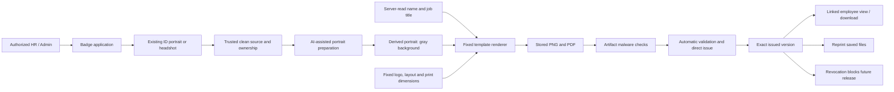

# AI-Assisted Employee Badge Generation architecture

## Business and implementation context

Employee badges needed a consistent design and a quicker preparation process. Staff could start with an authorized ID image or a separate headshot, but the original ID had to remain private. Name, title, portrait and issued files needed to stay tied to the same employee.

- Built portrait preparation from an existing authorized ID image or a standalone headshot, with source appearance and hairstyle preservation.
- Kept the template, logo, employee profile name and job title application-controlled; produced print-ready PNG/PDF badge artifacts.
- Implemented direct issuance, saved versions, reprints, revocation and protected employee self-service.
- Used a versioned Key Vault credential binding and separate operational controls for paid image cleanup and unused-artifact retention.

## Processing path

## Implementation layers

| Layer | What is included |
| --- | --- |
| Actual implementation excerpts | TypeScript policy/domain functions and their source tests; no hosted adapter or private record |
| Public local reference | Python demonstration and a loopback dashboard using fictional inputs |
| Infrastructure | Terraform resource boundaries, explicit inputs and mock plan tests |
| Actual cloud evidence | Existing platform context; new nonproduction portal captures are optional follow-up evidence |

## Trust and identity

- The real source ID stays private and is not the employee's downloadable badge artifact. Public examples contain no real employee image.
- The AI edits the portrait only. It does not draw trusted badge text or grant an application role.
- Issued copies require current employee binding and exact clean artifact proofs. Revocation prevents future release; it cannot recall a previously printed/downloaded copy.
- The public image adapter is Off by default, makes one bounded request when explicitly invoked and has no automatic paid retries.

## Deployment boundary

Two private badge containers on an existing scan-protected storage account, a reference application identity, container-scoped roles and optional exact-secret access. This root does not deploy the business API or activate paid image cleanup.

No resource was applied for this project packaging. A real deployment requires correct identities, network/DNS reachability, permissions, package/schema compatibility and recovery acceptance. The local dashboard is not an internet-facing multi-user application.
